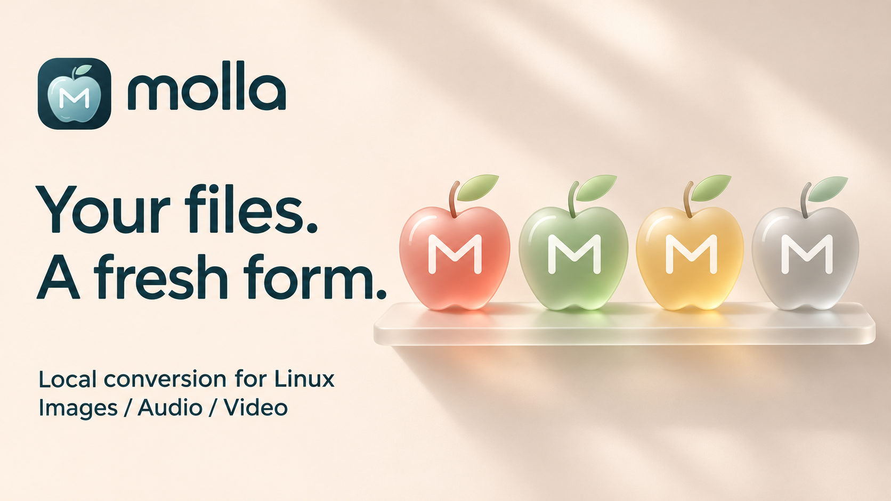
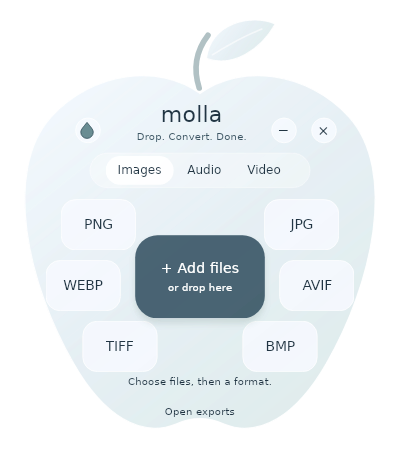

<p align="center"></p>

# Molla

**Drop. Convert. Done.**

A small, apple-shaped Linux desktop converter for images, audio, and video.
Choose files or drop them onto an output format. Molla converts them locally
and keeps the originals.



*Promotional artwork above. Actual application below.*

<p align="center"></p>

## What it does

- Convert by dropping files directly onto a format, or choose files first.
- Collapse into a small desktop apple; click to expand, drag to move, or drop files to select them.
- Switch between red, green, yellow, and gray glass tints on both apple views.
- Edit the opening shortcut from the color menu's **Shortcut** tab on configured GNOME/Zorin desktops.
- Export to **~/Downloads/Molla**, preserving originals and avoiding filename collisions.
- Cancel conversions without publishing a partial batch.

| Output category | Formats |
| --- | --- |
| Images | PNG, JPG, WebP, AVIF, TIFF, BMP |
| Audio | MP3, WAV, FLAC, M4A, OGG, Opus |
| Video | MP4, MOV, MKV, WebM, AVI, WMV |

Audio/video need FFmpeg and FFprobe on PATH. Codec availability depends on your
FFmpeg build. Image exports use a single-frame decoder and remove metadata.
An output format being listed does not mean every possible input is supported.

## Build and run

Requirements: Linux graphical session, .NET 10 SDK, Avalonia's Linux native
dependencies, and optional FFmpeg/FFprobe for media conversions.

From this repository's root:

```sh
dotnet restore src/Molla.Linux/Molla.Linux.csproj
dotnet build src/Molla.Linux/Molla.Linux.csproj -c Release --no-restore
./run-molla.sh
```

The launcher uses the `dotnet` command on PATH and opens the apple converter.
SDKs and package caches are not part of the source distribution.

## Everyday controls

| Action | Control |
| --- | --- |
| Select files | **Add files**, or drop onto the center |
| Convert immediately | Drop files onto a format |
| Move expanded apple | Drag the **molla** title |
| Collapse / expand | **−**, then click the mini apple |
| Move mini apple | Drag its body |
| Colors / shortcut | Droplet icon, then the relevant tab |
| Close | **×**, or your desktop's close-window shortcut |
| Find exports | **Open exports** |

The development machine uses **Ctrl + Alt + M** to open and **Alt + F4** to
close the focused window. These are desktop settings, not portable built-in
global hotkeys. See [setup](docs/SETUP.md) for a new installation.

## Glass appearance and current limits

Molla requests native blur where the compositor supports it. On the tested
Zorin/GNOME desktop, the compositor reports transparency only, so the app uses
translucent tinted glass without true background blur.

Color and file selection are session state; opening-shortcut changes are stored
in GNOME settings. There is no installer, automatic updater, persistent library,
web downloader, or document-editing workflow in the apple converter.
Multiple launches may create multiple windows.

## Development and verification

```sh
dotnet build src/Molla.Verify/Molla.Verify.csproj -c Release
dotnet src/Molla.Verify/bin/Release/net10.0/Molla.Verify.dll
```

The optional graphical test is described in [CONTRIBUTING.md](CONTRIBUTING.md).
It requires a configured GNOME shortcut and writes that same binding back during
its save test. It also tests colors, button hit areas, collapse/expand, and a
real conversion through the file-drop handler.

## Project map

- `src/Molla.Linux/` — Avalonia UI, shortcut editor, conversion adapter.
- `src/Molla.Core/` — the conversion code used by the Molla app.
- `src/Molla.Verify/` — conversion and graphical checks.
- `docs/` — setup, screenshots, icon, and social designs.
- `molla-video/` — editable Remotion product animation.

## Credits and publication

Molla includes conversion code derived from
[Nashi by Orkun Işıtmak and contributors](https://github.com/orkunisitmak/nashi-app).
Its MIT notice is preserved in [UPSTREAM-LICENSE.txt](UPSTREAM-LICENSE.txt).
Bundled DejaVu fonts retain their [license](src/Molla.Linux/Assets/Fonts/LICENSE).

## Press and social

[Social graphics, captions, and usage notes](docs/SOCIAL.md) ·
[Editable icon](docs/assets/brand/molla-icon.svg) ·
[Setup](docs/SETUP.md) ·
[Contribution guide](CONTRIBUTING.md)
